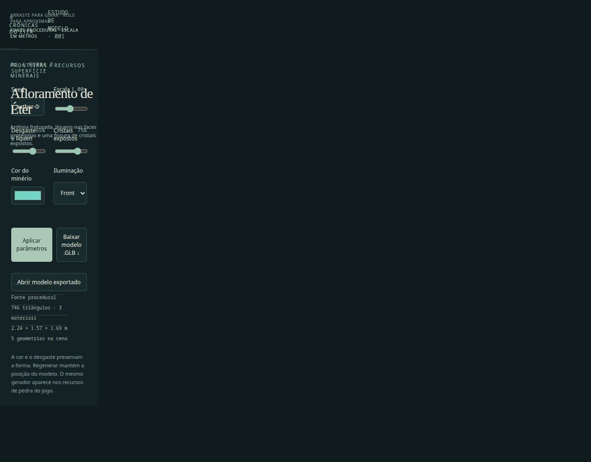
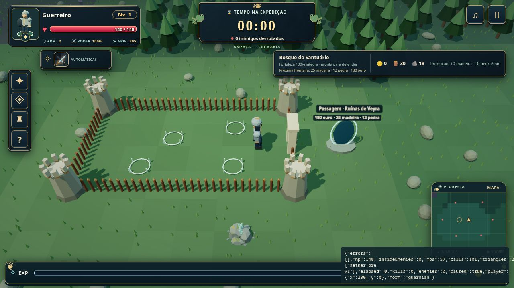

# Modelo 01 — Afloramento de Éter

Asset de recurso mineral para Crônicas do Éter, criado com a skill `procedural-3d`. Ardósia com faces de fratura planas, estratos minerais, líquens nas superfícies protegidas e cristais prismáticos concentrados numa fissura. Não usa texturas externas.



## Usar e reproduzir

```bash
npm run dev
npm run model:export
```

Abra `/tests/fixtures/aether-ore.html` no servidor de desenvolvimento para girar, ajustar parâmetros, comparar iluminação neutra e de fronteira, baixar o GLB e reabrir o arquivo exportado. A prévia é uma ferramenta de desenvolvimento e não entra no build da interface do jogo. Para conferir a câmera real com save em memória, abra `/tests/fixtures/3d-preview.html?ore&metrics`.

O exportador grava `public/models/aether-ore.glb` e seu manifesto JSON. Pode receber outro caminho: `npm run model:export -- /tmp/aether-ore.glb`. O formato público é GLB 2.0, com materiais PBR e cores por vértice. Os parâmetros padrão produzem 746 triângulos, 3 materiais e um arquivo de 84.580 bytes, com dimensões aproximadas de 2,24 × 1,57 × 1,69 metros. A versão usada na partida tem escala 0,62.

```js
import {createAetherOre,regenerateAetherOre,disposeAetherOre}
  from './src/render/three/assets/AetherOre.js';

const ore=createAetherOre({seed:'aether-001',id:'deposito-01',scale:1});
scene.add(ore);
ore.position.set(4,0,-2);
regenerateAetherOre(ore,{crystalColor:'#9abbe8',weathering:.4});
// Ao remover definitivamente o asset:
disposeAetherOre(ore);
```

| Parâmetro | Padrão | Contrato |
| --- | --- | --- |
| `seed` | `aether-001` | String de 1–128 caracteres; define a família de variação |
| `id` | `ore-001` | String de 1–128 caracteres; identidade estável durante regenerações |
| `scale` | `1` | Escala uniforme de 0,1 a 5 |
| `weathering` | `0.65` | De 0 a 1; coloração basal e cobertura de líquens |
| `crystalAmount` | `0.75` | De 0 a 1; quantidade de cristais expostos |
| `crystalColor` | `#73d6c4` | Cor hexadecimal `#RRGGBB` |

Eixo vertical Y, unidades em metros, sistema destro e origem no plano de apoio. A seed usa FNV-1a e Mulberry32 com canais separados por identidade. Cor e desgaste preservam a geometria principal. Regenerar mantém o grupo, pai, transformações e elementos externos anexados; somente as malhas geradas são substituídas e descartadas. O consumidor possui o posicionamento. Parâmetros inválidos deixam o modelo anterior intacto. A geometria pode mudar em versões futuras do gerador; o manifesto registra a versão e a revisão do Three.js.

O asset combina sólidos sobrepostos e pequenas superfícies decorativas; é destinado à renderização, não a fabricação como uma única malha estanque.

## Validação executada

- 30 combinações de seed, escala e quantidade de cristais, com posições finitas, normais, orientação, áreas e bounds conferidos.
- Reprodução, independência da ordem de geração, alteração de cor/desgaste sem mudar a rocha e escala uniforme.
- 15 regenerações com preservação de transformações, cena e elementos externos, além de descarte e rejeição de entradas inválidas.
- Exportação e reabertura por GLTFLoader, conferindo geometria, materiais, dimensões e correspondência ao artefato publicado.
- Inspeção no navegador sob luz de fronteira e neutra, outra seed, download GLB, layout móvel e recurso na câmera real do jogo.
- `npm test`, `npm run build` e `git diff --check`. O build mantém o aviso de bundle JavaScript acima de 500 kB.


